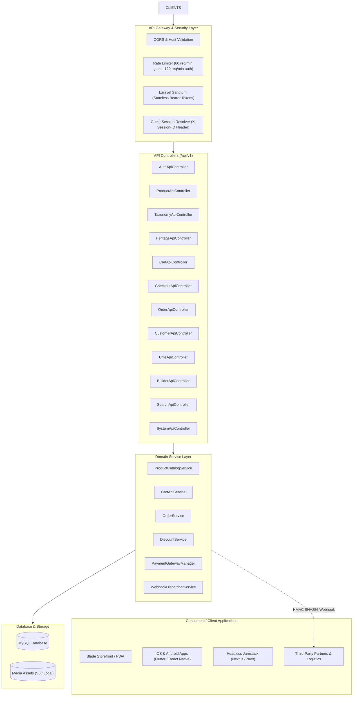
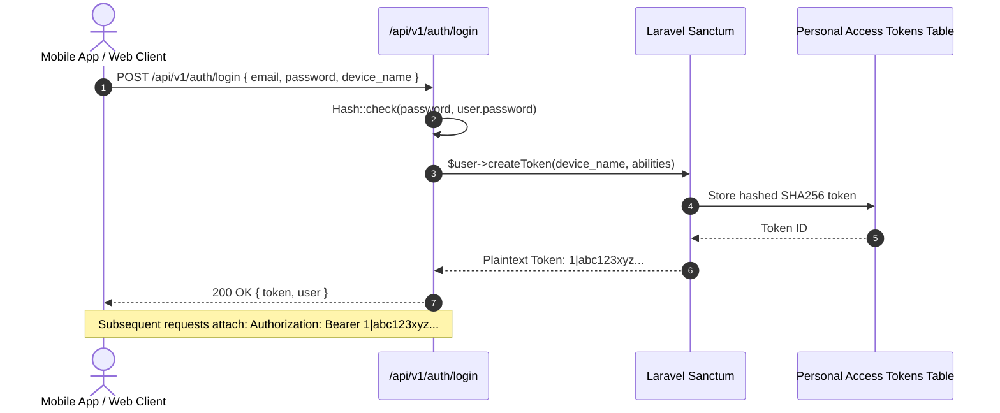

# Sorolata Commerce Platform — Part 08: API Architecture & Future Scalability Specification

## 1. Executive Summary & Architectural Philosophy
The Sorolata API Architecture transforms the platform into an **API-first, headless-capable, mobile-ready commerce engine**. Built on Laravel 12 with PHP 8.2+, the architecture provides a unified backend powering:
1. **Web Storefront**: Blade + Livewire 3 + Alpine.js + Tailwind CSS.
2. **Mobile Applications**: Native iOS and Android apps (via Flutter / React Native).
3. **Headless Frontends**: Next.js, Nuxt.js, or Remix frontends consuming structured JSON.
4. **Third-Party Integrations**: Couriers (Pathao, Steadfast, RedX, DHL), Payment Gateways (bKash, Nagad, SSLCommerz, Stripe), and ERPs.



---

## 2. Universal API Response Envelope

Every endpoint adheres strictly to a standardized JSON envelope ensuring predictability for client engineers:

```json
{
  "success": true,
  "message": "Request completed successfully.",
  "data": { ... },
  "meta": {
    "pagination": {
      "current_page": 1,
      "last_page": 5,
      "per_page": 12,
      "total": 60,
      "has_more_pages": true
    }
  },
  "errors": []
}
```

### Error Envelope Example (HTTP 422 Unprocessable Content):
```json
{
  "success": false,
  "message": "The given data was invalid.",
  "data": null,
  "meta": [],
  "errors": {
    "customer_phone": [
      "The customer phone field is required."
    ],
    "shipping_address.city": [
      "The city field must be a string."
    ]
  }
}
```

---

## 3. Authentication & Session Strategy



### Hybrid Guest & Authenticated Session
Sorolata allows mobile and headless clients to maintain persistent shopping carts and wishlists across state changes:
1. **Authenticated Users**: Sanctum `auth:sanctum` middleware identifies the user by Bearer token.
2. **Guest Users**: The client generates and transmits a persistent UUID via the `X-Session-ID` header.
3. **Cart Merger**: Upon user login, any pending guest cart items identified by `X-Session-ID` are seamlessly reconciled into the customer's permanent database profile.

---

## 4. API Endpoints Catalog (52 Versioned Endpoints)

### Module 01: Authentication (`/api/v1/auth`)
| Method | Route | Description | Auth Required |
| :--- | :--- | :--- | :--- |
| `POST` | `/api/v1/auth/register` | Register new customer account | No |
| `POST` | `/api/v1/auth/login` | Issue Sanctum Bearer token for mobile/web | No |
| `POST` | `/api/v1/auth/logout` | Revoke current access token | Yes (Sanctum) |
| `GET` | `/api/v1/auth/me` | Retrieve authenticated user profile | Yes (Sanctum) |
| `POST` | `/api/v1/auth/update-password` | Update account password | Yes (Sanctum) |

### Module 02: Products & Curated Reviews (`/api/v1/products`)
| Method | Route | Description | Auth Required |
| :--- | :--- | :--- | :--- |
| `GET` | `/api/v1/products` | Paginated catalog with multi-facet filters | No |
| `GET` | `/api/v1/products/{uuidOrSlug}` | Detailed product with variants & provenance | No |
| `GET` | `/api/v1/products/{id}/related` | Up to 4 algorithmically related heirlooms | No |
| `GET` | `/api/v1/products/{id}/reviews` | Approved collector testimonials with curator notes | No |
| `POST` | `/api/v1/products/{id}/reviews` | Submit new verification review | Yes (Sanctum) |

### Module 03: Taxonomies (`/api/v1/categories`, `/api/v1/collections`)
| Method | Route | Description | Auth Required |
| :--- | :--- | :--- | :--- |
| `GET` | `/api/v1/categories` | Root and nested category hierarchy | No |
| `GET` | `/api/v1/categories/{slug}` | Category details + paginated products | No |
| `GET` | `/api/v1/collections` | Curated editorial collection lists | No |
| `GET` | `/api/v1/collections/{slug}` | Collection narrative + products | No |

### Module 04: Heritage Geography & Artisans (`/api/v1/divisions`, `/api/v1/districts`, `/api/v1/artisans`)
| Method | Route | Description | Auth Required |
| :--- | :--- | :--- | :--- |
| `GET` | `/api/v1/divisions` | All 8 Bangladesh administrative divisions | No |
| `GET` | `/api/v1/districts` | 64 districts with craft specializations | No |
| `GET` | `/api/v1/districts/{slugOrName}` | District profile, historical lore & artisan roster | No |
| `GET` | `/api/v1/artisans` | Directory of master guild weavers & potters | No |
| `GET` | `/api/v1/artisans/{uuidOrId}` | Master profile, biography & crafted products | No |

### Module 05: Persistent Shopping Cart (`/api/v1/cart`)
| Method | Route | Description | Auth Required |
| :--- | :--- | :--- | :--- |
| `GET` | `/api/v1/cart` | Show active cart contents & totals | Hybrid (Sanctum / X-Session-ID) |
| `POST` | `/api/v1/cart/items` | Add product or variant to cart | Hybrid (Sanctum / X-Session-ID) |
| `PUT` | `/api/v1/cart/items/{itemId}` | Adjust item quantity | Hybrid (Sanctum / X-Session-ID) |
| `DELETE` | `/api/v1/cart/items/{itemId}` | Remove item from cart | Hybrid (Sanctum / X-Session-ID) |
| `POST` | `/api/v1/cart/coupon` | Validate and apply promotional code | Hybrid (Sanctum / X-Session-ID) |
| `DELETE` | `/api/v1/cart/coupon` | Detach promotional code | Hybrid (Sanctum / X-Session-ID) |

### Module 06: Checkout & Order Execution (`/api/v1/checkout`)
| Method | Route | Description | Auth Required |
| :--- | :--- | :--- | :--- |
| `GET` | `/api/v1/checkout/gateways` | Available payment drivers (bKash, Nagad, COD) | No |
| `GET` | `/api/v1/checkout/shipping-rates` | Active shipping tiers (Standard, Express) | No |
| `POST` | `/api/v1/checkout/calculate` | Pre-calculate subtotal, discounts & tax | No |
| `POST` | `/api/v1/checkout/process` | Place order, deduct stock & dispatch webhooks | Hybrid (Sanctum / Guest) |
| `POST` | `/api/v1/checkout` | Alias to process for legacy compatibility | Hybrid (Sanctum / Guest) |

### Module 07: Order Tracking & Invoices (`/api/v1/orders`)
| Method | Route | Description | Auth Required |
| :--- | :--- | :--- | :--- |
| `GET` | `/api/v1/orders` | Customer order ledger history | Yes (Sanctum) |
| `GET` | `/api/v1/orders/{orderNumber}` | Single order details & line items | No (Authorized by number) |
| `GET` | `/api/v1/orders/{orderNumber}/tracking` | Real-time courier timeline status | No |
| `GET` | `/api/v1/orders/{orderNumber}/invoice` | Structured certificate payload for PDF/printing | No |
| `POST` | `/api/v1/orders/{orderNumber}/return` | Lodge return/exchange requisition | Yes (Sanctum) |

### Module 08: Customer CRM & Wishlist (`/api/v1/customer`)
| Method | Route | Description | Auth Required |
| :--- | :--- | :--- | :--- |
| `GET` | `/api/v1/customer/profile` | Detailed customer profile with metrics | Yes (Sanctum) |
| `PUT` | `/api/v1/customer/profile` | Update profile information | Yes (Sanctum) |
| `GET` | `/api/v1/customer/addresses` | Customer address book | Yes (Sanctum) |
| `POST` | `/api/v1/customer/addresses` | Add new shipping/billing address | Yes (Sanctum) |
| `GET` | `/api/v1/customer/wishlist` | Active wishlist products | Hybrid (Sanctum / X-Session-ID) |
| `POST` | `/api/v1/customer/wishlist/toggle` | Toggle product in/out of wishlist | Hybrid (Sanctum / X-Session-ID) |

### Module 09: CMS & Aggregated Mobile Homepage (`/api/v1/cms`)
| Method | Route | Description | Auth Required |
| :--- | :--- | :--- | :--- |
| `GET` | `/api/v1/homepage/sections` | **High-performance aggregated homepage** payload (Hero, Collections, Featured Artisans, Heritage Districts, Stories, Trust Badges) in a single HTTP call | No |
| `GET` | `/api/v1/stories` | Editorial journal articles & heritage gazette | No |
| `GET` | `/api/v1/stories/{slug}` | Deep narrative story by slug | No |
| `GET` | `/api/v1/pages/{slug}` | Static institutional pages (About, Craft Guilds) | No |

### Module 10: Headless Visual Page Builder (`/api/v1/builder`)
| Method | Route | Description | Auth Required |
| :--- | :--- | :--- | :--- |
| `GET` | `/api/v1/builder/layout/{type}/{idOrSlug}` | Normalized block sequence JSON for Next.js / Flutter rendering | No |
| `GET` | `/api/v1/builder/components` | Global reusable UI blocks | No |

### Module 11: Unified Search & Suggestions (`/api/v1/search`)
| Method | Route | Description | Auth Required |
| :--- | :--- | :--- | :--- |
| `GET` | `/api/v1/search` | Multi-entity search (products, artisans, stories) | No |
| `GET` | `/api/v1/search/suggestions` | Instant autocomplete search suggestions | No |

### Module 12: System Configuration & Feature Flags (`/api/v1/system`)
| Method | Route | Description | Auth Required |
| :--- | :--- | :--- | :--- |
| `GET` | `/api/v1/system/config` | Store info, currencies, languages, tokens, & flags | No |
| `GET` | `/api/v1/notifications` | In-app user notifications list | Yes (Sanctum) |

---

## 5. Mobile App Aggregation Optimization

Mobile latency and cellular round-trips are minimized by the **Aggregated Mobile Homepage** (`GET /api/v1/homepage/sections`). Instead of firing 7 distinct HTTP requests on application launch, a single call returns:

```json
{
  "success": true,
  "message": "Homepage sections retrieved successfully.",
  "data": {
    "announcement": { "text": "Complimentary White-Glove Insured Delivery...", "link_url": "/shop" },
    "hero": { "headline": "Living Heritage, Handcrafted for Generations", "cta_text": "Explore Heirlooms" },
    "featured_collections": [ ... ],
    "curated_products": [ ... ],
    "heritage_districts": [ ... ],
    "master_artisans": [ ... ],
    "editorial_stories": [ ... ],
    "trust_badges": [ ... ]
  }
}
```

---

## 6. Outbound Webhook Subsystem

The webhook engine dispatches asynchronous event payloads to third-party subscribers with cryptographic HMAC SHA-256 signatures:

```php
$signature = hash_hmac('sha256', json_encode($payload), $webhook->secret);
```

### HTTP Headers Sent to Subscribers:
- `X-Sorolata-Event`: `order.created` | `order.dispatched` | `inventory.low_stock`
- `X-Sorolata-Signature`: Hex-encoded SHA256 HMAC digest
- `X-Sorolata-Delivery`: Unique UUID for idempotency checking
- `User-Agent`: `Sorolata-Commerce-Webhook/1.0`

---

## 7. Interactive Scalar OpenAPI Documentation

An interactive, searchable documentation viewer is available at:
- **Web UI Viewer**: `http://localhost/sorolata/public/docs/api` (powered by Scalar API Reference)
- **OpenAPI 3.0 Specification**: `http://localhost/sorolata/public/docs/openapi.yaml`

The documentation features:
- Complete Bearer token authorization tester
- Request/Response schemas for all 52 endpoints
- Curl and JavaScript/Flutter code snippet generator
- Branded with Sorolata's heritage design tokens (Forest Green, Terracotta, Cream)

---

## 8. Automated Test Verification

The API Architecture has been validated with a dedicated automated feature test suite (`tests/Feature/ApiArchitectureSuiteTest.php`):
- **12 Feature Tests**: 100% Passing.
- **168 Assertions**: Validating JSON envelope, auth flows, guest sessions, catalog filters, stock decrements, and documentation endpoints.
- **Platform-wide Suite**: **73 tests, 506 assertions** across all 8 modules execute with 100% green status.
