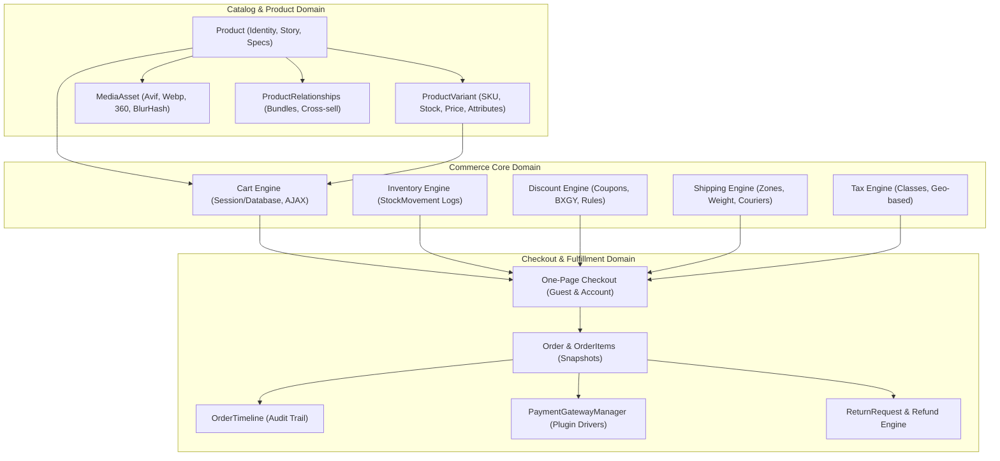

# Sorolata Commerce Platform
## PART 05 — Commerce Engine Specification (Products, Orders, Inventory & Checkout)

### 1. Executive Summary & Philosophy
Sorolata's Commerce Engine is designed not merely as a transactional database, but as a multi-dimensional content, storytelling, and revenue engine. Every product acts as:
- **A Story**: Deeply rooted in geographical provenance (GI certification, river basins, artisan ateliers).
- **A Landing Page**: Modularity powered by the Visual Page Builder JSON Layout Engine.
- **A Marketing Asset**: Rich OpenGraph, Google Merchant rich snippets, high-resolution media, 360° views.
- **A Sellable Item**: Multiple SKUs, dynamic variants, inventory tracking, multi-currency pricing, and tax classes.

Built for **B2C today**, the architecture is inherently extensible to **B2B wholesale**, **Multi-vendor artisan guilds**, and a **White-label SaaS Commerce Platform**.

---

### 2. Domain Architecture Overview

---

### 3. Detailed Subsystem Specifications

#### 3.1 Product & Variant Engine
- **Identity & Coding**: `uuid` (external secure identifier), `sku` (standardized SKU e.g. `SRL-MSL-001`), `barcode` (EAN-13/UPC), `slug` (canonical SEO URL), `internal_code`.
- **Product Types**:
  - `physical`: Standard handloom, brassware, pottery requiring freight shipping.
  - `digital`: PDF guides, masterclass videos, architectural high-res photography.
  - `gift_card`: Digital or engraved physical voucher with redemption code.
  - `bundle`: Group of artisan pieces discounted as a curated set.
  - `service`: Custom atelier weaving consultation.
- **Variant Architecture**:
  - Unlimited attributes: `Color`, `Size`, `Material`, `Weave Density`, `Finish`, `Length`.
  - Independent SKU, stock, pricing, and images per variant.
- **Heritage & Storytelling Metadata**:
  - District, Division, Artisan Guild, GI Registration Number, River Basin, Craft Type, Handmade Duration (e.g. "34 Days On Pit Loom"), Traditional Care Instructions.

#### 3.2 Inventory Engine & Audit Trail
- **Zero Silent Quantity Modifications**: Every stock adjustment creates an immutable `InventoryLog` entry.
- **Log Types**:
  - `purchase`: New stock received from artisan guild.
  - `adjustment`: Stock audit reconciliation by staff.
  - `reservation`: Placed in active checkout / pending payment.
  - `sale`: Confirmed order deduction.
  - `return`: Restocked item from approved customer return.
  - `damage`: Broken/flawed piece written off with reason.
- **Out of Stock Behavior**: Configurable per product: `deny` (stop checkout), `continue` (allow backorder), `notify` (waitlist trigger).

#### 3.3 Cart & Frictionless Checkout Engine
- **AJAX & REST**: Pure asynchronous JSON operations.
- **Features**:
  - Add to cart with variant selection.
  - Item quantity updates and instantaneous subtotal recalculation.
  - Save for Later / Move to Wishlist.
  - Dynamic coupon validation with real-time feedback.
  - Gift wrapping toggle with personalized calligraphy card note.
  - Transparent shipping rate calculator based on customer's selected district.
- **One-Page Checkout**:
  - Seamless guest checkout and customer account toggle.
  - Saved addresses for logged-in collectors.
  - Live order summary with breakdown of subtotal, discounts, shipping, taxes, and gift options.

#### 3.4 Payment Gateway Plugin Architecture
The system adopts a modular driver-based approach via `PaymentGatewayManager`:
- **SSLCommerz**: Hosted session initiation and IPN callback verification.
- **bKash**: Direct checkout integration with tokenized authorization.
- **Nagad**: Direct API gateway.
- **Rocket**: Dutch-Bangla Bank mobile payment integration.
- **Stripe**: International card payments (USD/EUR/GBP) for expat collectors.
- **PayPal**: Global checkout integration.
- **Cash on Delivery (COD)**: Available for Bangladesh domestic orders with verification lock.

#### 3.5 Shipping & Fulfillment Engine
- **Hierarchical Shipping Zones**:
  - *Zone 1: Dhaka Metropolitan* (Next-day courier, flat rate ৳80, free above ৳3,000).
  - *Zone 2: Rest of Bangladesh* (2-4 days, weight-tiered: ৳130 base + ৳30/kg).
  - *Zone 3: Global Expat Courier (USA, UK, Canada, Europe, Australia)* (DHL/FedEx insured air courier with volumetric weight calculation).
- **Courier Integration Ready**: Pre-architected payload structures for RedX, Steadfast, Pathao, and DHL Express.

#### 3.6 Order Lifecycle & Audit Timeline
- **Order States**:
  - `pending` → `confirmed` → `packed` → `shipped` → `delivered` → `completed`
  - Cancellation/Refund branches: `cancelled`, `refunded`.
- **OrderTimeline**:
  - Logs exact timestamp, actor (`system`, `customer`, `staff:id`), notes, and whether notification was dispatched to the customer.

#### 3.7 Returns & Refund Workflow
- Customer initiates return with reason (`damaged_in_transit`, `craft_defect`, `collector_exchange`) and photos.
- Staff reviews and approves/rejects in admin.
- Refund processing: Full refund, Partial refund, or Store credit voucher.
- Automated stock replenishment upon verified receipt at the warehouse.

#### 3.8 REST API Suite (`/api/v1`)
Full decoupled headless support for mobile apps and future third-party integrations:
- `GET /api/v1/products` & `GET /api/v1/products/{id_or_slug}`
- `GET /api/v1/cart` & `POST /api/v1/cart/items`
- `PUT /api/v1/cart/items/{key}` & `DELETE /api/v1/cart/items/{key}`
- `POST /api/v1/cart/coupon`
- `POST /api/v1/checkout`
- `GET /api/v1/orders/{orderNumber}`

---

### 4. Golden Rules Enforced
1. **Never Duplicate Product Data**: Pricing and inventory reside in canonical rows; order items take immutable snapshot copies at checkout.
2. **Never Hardcode Business Rules**: All shipping zones, coupon conditions, payment gateway keys, and tax rates are configurable.
3. **Decoupled Architecture**: Inventory, Pricing, Shipping, Tax, and Payment operate as independent testable service classes.
4. **Performance by Default**: Asynchronous event dispatching, indexed queries, and minimal synchronous blocking.
