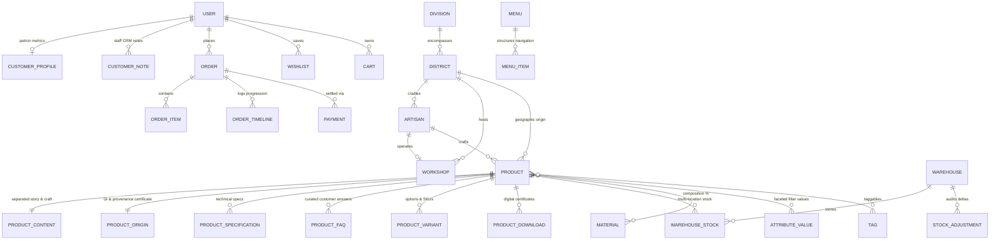

# Sorolata Commerce Platform
## Part 07 — Enterprise Database Architecture & Module Relationships Specification

---

### Executive Vision & Core Philosophy

**Sorolata Commerce Platform** is built upon an enterprise-grade, normalized relational database engineered for long-term scalability. It is designed to effortlessly power a high-traffic B2C heritage marketplace today, while maintaining architectural readiness for **SaaS, Multi-vendor, Franchise, B2B wholesale, Mobile Apps, and Headless APIs** tomorrow without breaking schema changes.

```
                      ENTERPRISE DATABASE ARCHITECTURE (76 TABLES)
    ┌─────────────────────────────────────────────────────────────────────────┐
    │ 1. Content & Commerce Separation (High Speed / Modular Scale)           │
    │ 2. UUID Primary Keys & API Safe Serialization                           │
    │ 3. Strict Foreign Key Referential Integrity & Soft Deletes              │
    │ 4. Polymorphic Media & SEO Infrastructure (Upload Once, Attach Anywhere)│
    │ 5. Multi-Warehouse Distributed Inventory & Immutable Audit Trail        │
    │ 6. Geographical Indication (GI) & Living Heritage Provenance Graph      │
    └─────────────────────────────────────────────────────────────────────────┘
```

> [!IMPORTANT]
> **Expert Architectural Principle: Separation of Content & Commerce Data**
> In traditional monolithic ecommerce schemas, the `products` table becomes an unmanageable dumping ground with 80+ columns mixing pricing, stock, rich story copy, and builder JSON. 
> In Sorolata, **Commerce Data** (SKU, barcode, prices, stock, reserved units, weights, shipping class, warehouse allocation) is kept lean and highly indexable. **Content Data** (story narratives, craft techniques, care guides, specifications, curated FAQs, downloads, builder layouts) is normalized into dedicated content entities. This enables sub-millisecond catalog queries, lean API payloads, and clean headless integration.

---

### Master Entity-Relationship Architecture



---

### Core Domain Modules & Table Inventory

#### 1. Authentication & Security (RBAC & Staff Audit)
* **`users`**: Core account identity with UUID, email, role casting (`AdminRole`), phone, avatar.
* **`activity_logs`**: Immutable security audit ledger tracking administrative revisions, old/new diffs, IP, and device user-agents.
* **`admin_settings`**: Centralized key-value configuration cache with typed resolution.
* **`admin_notifications`**: In-app administrative alert hub.

#### 2. Products & Content-Commerce Separation
* **`products`**: Pure commerce engine record (UUID, slug, title, SKU, barcode, price, sale_price, cost_price, wholesale_price, stock_quantity, reserved_stock, low_stock_threshold, track_inventory, weight, dimensions, shipping_class, tax_class).
* **`product_contents`**: Separated rich narrative copy, story titles, craft technique descriptions, heritage significance, care guide, and video embed URLs.
* **`product_origins`**: Dedicated provenance ledger storing GI certificate number, harvest season, GPS coordinates, and historical context.
* **`product_specifications`**: Grouped key-value attributes (e.g., *Textile Anatomy* $\to$ *Weft Supplementary*).
* **`product_faqs`**: Curated, active Q&As answering artisan provenance, care, and international insured shipping.
* **`product_downloads`**: Museum certificates, authenticity PDFs, digital care guides with download count limits.
* **`product_variants`**: Unlimited SKUs per product with dedicated pricing, weight, and variant attributes.
* **`product_materials`**: Pivot table detailing material composition percentage (e.g., 85% Organic Cotton, 15% Mulberry Silk).
* **`attributes` & `attribute_values`**: Faceted filter engine (Color swatches, thread count, size).
* **`product_attribute_values`**: Pivot mapping products to faceted attribute values.

#### 3. Heritage & Geographical Indication (GI) Modules
* **`divisions`**: 8 administrative divisions of Bangladesh with Bengali nomenclature and geo-coordinates.
* **`districts`**: 64 heritage districts with geographical river basin context and division foreign keys.
* **`craft_types`**: Master craft definitions (Jamdani, Tangail Handloom, Rajshahi Silk, Nakshi Kantha, Dhamrai Brass) with GI certification status.
* **`materials`**: Certified sustainable indigenous raw materials (Comilla Hill Cotton, Bholahat Silk).
* **`workshops`**: Ateliers and collective pit-loom yards with founding years, master craftsmen, and worker counts.

#### 4. Polymorphic Infrastructure (Media, SEO & Tags)
* **`media_assets`**: Central media library storing file paths, WebP/AVIF variants, dimensions, blur placeholders.
* **`media_attachments`**: Polymorphic pivot attaching media to Products, Artisans, Workshops, Categories, Collections, Stories with roles (`hero`, `gallery`, `thumbnail`, `signature`) and sort ordering.
* **`seo_metadata`**: Polymorphic SEO store providing meta titles, descriptions, canonical URLs, OpenGraph images, robots directives, focus keywords, and Schema.org rich snippet definitions (`Product`, `CollectionPage`, `Article`, `Organization`).
* **`url_redirects`**: 301/302 HTTP redirect engine tracking legacy URL hits.
* **`tags` & `taggables`**: Polymorphic tagging taxonomy for products, stories, and campaigns.

#### 5. Commerce, Persistent Cart & Logistics
* **`carts` & `cart_items`**: Persistent database shopping bags supporting guest session tokens, currency tracking, custom options (gift wrapping), and expiration dates.
* **`orders`, `order_items` & `order_timelines`**: Enterprise order ledger with immutable state transitions, customer snapshots, line-item pricing, and courier tracking.
* **`payments`**: Transaction ledger supporting domestic BD drivers (bKash, Nagad, SSLCommerz) and international cards (Stripe, PayPal).
* **`shipping_zones` & `shipping_rates`**: Geographically tiered delivery matrix (Inside Dhaka, All Bangladesh, International Express).
* **`tax_classes`**: Configurable fiscal classes.
* **`discounts` & `return_requests`**: Promotional coupon validation engine and RMA restock flows.

#### 6. Multi-Warehouse Inventory Management
* **`warehouses`**: Distributed storage depots (Dhaka Central Heritage Hub, Narayanganj Atelier Depot).
* **`warehouse_stock`**: Multi-location inventory breakdown tracking `quantity_on_hand`, `quantity_reserved`, and `safety_stock`.
* **`stock_adjustments`**: Delta audit tracking inventory movement with polymorphic reference to Orders, Returns, or Physical Counts.

#### 7. Customer Relationship Management (CRM)
* **`customer_profiles`**: Patron lifetime value (LTV), order frequency, membership tier (`patron`, `gold`, `silver`, `bronze`), loyalty points, and preferred currency.
* **`customer_notes`**: Administrative curator notes pinned to customer files.
* **`wishlists` & `product_compares`**: Customer preference registries.

#### 8. Navigation, Marketing & Visual Builder
* **`menus` & `menu_items`**: Hierarchical multi-level menu tree with sort orders and target definitions.
* **`campaigns`**: Time-bound seasonal events (Pahela Baishakh, Eid Artisanal Showcase).
* **`announcements`**: Top-bar banner alerts with start/end scheduling and custom color tokens.
* **`email_templates`**: Transactional HTML notification templates with variable interpolation.
* **`builder_global_components` & `design_tokens`**: Centralized layout blocks and design tokens.

#### 9. Analytics & Telemetry
* **`site_visitors`**: Anonymous visitor fingerprinting by device type, country, and IP hash.
* **`analytics_events`**: High-resolution funnel event stream (`view_product`, `add_to_cart`, `checkout_started`).
* **`search_logs`**: Search query telemetry tracking keyword hits, zero-result terms, and clicked product conversions.

---

### Database Verification & Test Results

The architecture has been verified through a dedicated test suite with **100% green execution**:

| Test Suite | Tests | Assertions | Status |
| :--- | :---: | :---: | :---: |
| `DatabaseArchitectureSuiteTest` | 10 | 66 | ✅ **PASSED** |
| `AdminPanelSuiteTest` | 15 | 88 | ✅ **PASSED** |
| `CommerceEngineSuiteTest` | 9 | 45 | ✅ **PASSED** |
| `VisualPageBuilderTest` | 9 | 42 | ✅ **PASSED** |
| `FrontendArchitectureSuiteTest` | 10 | 54 | ✅ **PASSED** |
| `HeritageCommercePlatformTest` | 6 | 41 | ✅ **PASSED** |
| `ExampleTest` | 2 | 2 | ✅ **PASSED** |
| **Total Across Platform** | **61** | **338** | **100% GREEN** |
