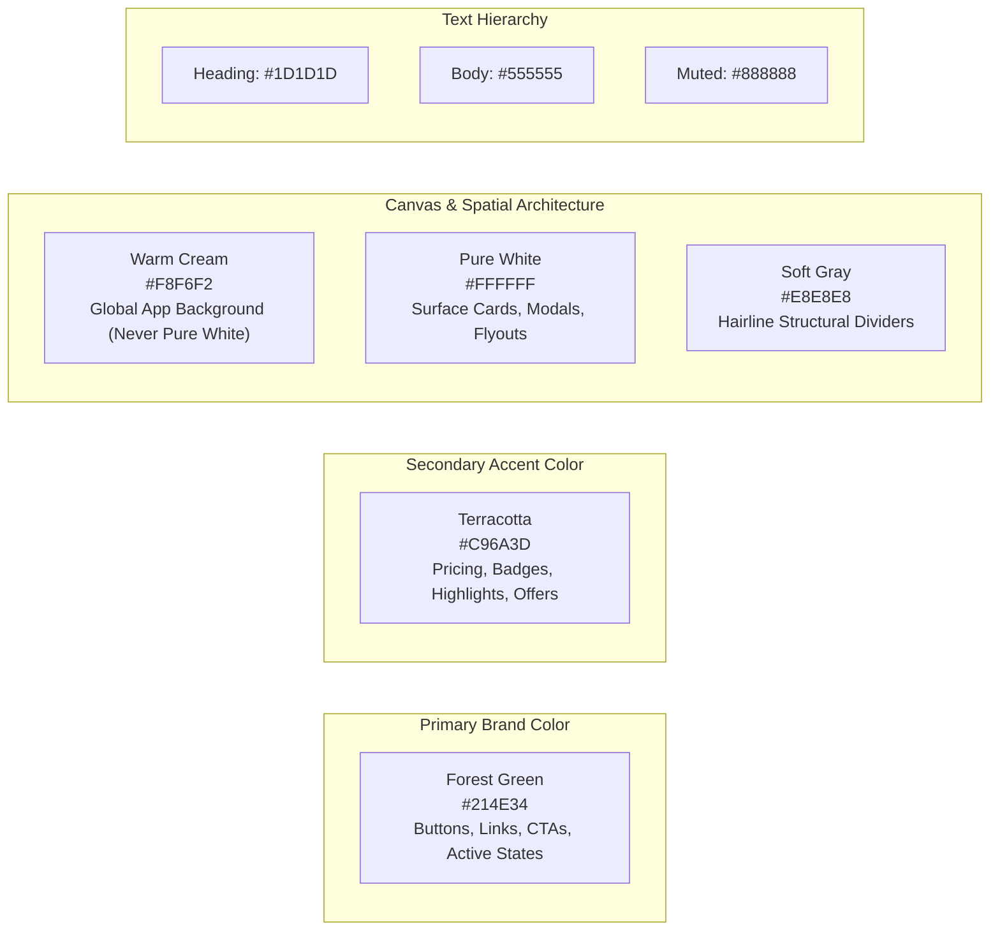

# Sorolata Commerce Platform
## Design System & UI/UX Architecture Specification (Part 02)

---

### Master Philosophy & Brand Personality

The Sorolata design language is defined as **Organic Luxury & Editorial Handcraft**. Inspired by the quiet restraint of **Apple**, the sensory warmth of **Aesop**, the purity of **Muji**, the artisanal provenance of **Etsy**, the tactile textures of **Zara Home**, and the modern micro-interactions of **Framer** and **Notion**.

```
                        THE SOROLATA UI CREED
   "The interface must gracefully disappear so the craftsmanship becomes the hero."
```

#### Core Personality Pillars
- **Calm & Warm**: Generous negative space, warm organic cream undertones (never harsh digital white).
- **Tactile & Natural**: Rich authentic photography celebrating subtle thread slubs, bell-metal hammer facets, and unrefined fibers.
- **Trustworthy & Authoritative**: Verified artisan lineage, Geographical Indication badges, transparent material composition metrics.
- **Modern Minimal**: Micro-interactions that feel slow, smooth, and grounded in physical physics.

---

### The Color System

The palette is rooted in Bengal's natural biosphere—deep tropical forests, alluvial terracotta soil, and unbleached wild silks.



#### Exact Hex Codes & Tokens
| Token | Hex Code | Role & Usage Restrictions |
|---|---|---|
| `--color-primary` | `#214E34` | **Forest Green**: Primary buttons, links, active navigation, key icons |
| `--color-secondary` | `#C96A3D` | **Terracotta**: Price tags, sale/GI badges, highlights, accents |
| `--color-bg` | `#F8F6F2` | **Warm Cream**: Primary background (never replace with `#FFF`) |
| `--color-surface` | `#FFFFFF` | **Surface White**: Elevated cards, sheets, dropdowns |
| `--color-border` | `#E8E8E8` | **Soft Gray**: 1px subtle architectural containment |
| `--text-heading` | `#1D1D1D` | **Charcoal Obsidian**: Headings, titles, high contrast |
| `--text-body` | `#555555` | **Earthy Slate**: Long-form editorial body, descriptions |
| `--text-muted` | `#888888` | **Subtle Pewter**: Meta notes, timestamps, helper labels |
| `--color-success` | `#2D6A4F` | Order confirmed, verified guild checkmarks |
| `--color-warning` | `#D97706` | Low stock counter, pre-order reservation notices |
| `--color-error` | `#B91C1C` | Form validation errors, card decline alerts |

---

### Typography Scale & Font Architecture

Sorolata pairs classical literary serifs with ultra-legible modern sans-serifs, complemented by authentic Bangla typography:

```
[ English Headings ] -> Cormorant Garamond (Light 300, Regular 400, Medium 500)
[ English Body     ] -> Manrope (Light 300, Regular 400, Medium 500, SemiBold 600)
[ Bangla Text      ] -> Hind Siliguri (Regular 400, Medium 500, Bold 700)
[ Fallback         ] -> -apple-system, BlinkMacSystemFont, "Segoe UI", sans-serif
```

#### Strict Mathematical Scale
| Level | Font Size (px / rem) | Line Height | Tracking | Recommended Weight |
|---|---|---|---|---|
| **Hero Display** | `72px` (`4.5rem`) | `1.08` | `-0.025em` | Cormorant Garamond 300/400 |
| **Heading 1 (H1)** | `56px` (`3.5rem`) | `1.12` | `-0.02em` | Cormorant Garamond 400 |
| **Heading 2 (H2)** | `44px` (`2.75rem`) | `1.18` | `-0.015em` | Cormorant Garamond 400/500 |
| **Heading 3 (H3)** | `32px` (`2.0rem`) | `1.25` | `-0.01em` | Cormorant Garamond 500 |
| **Heading 4 (H4)** | `24px` (`1.5rem`) | `1.33` | `0` | Manrope 600 / Cormorant 600 |
| **Body (Editorial)**| `18px` (`1.125rem`)| `1.65` | `0` | Manrope 400 |
| **Small (UI)** | `16px` (`1.0rem`) | `1.50` | `+0.01em` | Manrope 400/500 |
| **Caption / Meta** | `14px` (`0.875rem`)| `1.42` | `+0.025em` | Manrope 500 (Uppercase) |

---

### Spatial Geometry: The 8pt Grid & Border Radii

All padding, margins, containers, and offsets strictly snap to multiples of the **8pt grid**:
`8px`, `12px` (sub-token), `16px`, `24px`, `32px`, `48px`, `64px`, `96px`, `128px`.

#### Border Radius Hierarchy
- **Small (`12px`)**: Input elements, dropdown items, tooltips.
- **Medium (`18px`)**: Notification toasts, pill chips, inner media wraps.
- **Large (`24px`)**: Modals, drawer sheets, category banners.
- **Extra Large (`32px`)**: Product Cards, Artisan Spotlight stage, Feature containers.
- **Buttons / Pills (`999px`)**: All action buttons, status pills, filter chips.

#### Elevation & Shadows
- **Depth over Darkness**: Avoid heavy black drop-shadows.
- **Soft Ambient Diffusion**:
  - `shadow-soft-xs`: `0 2px 4px rgba(33, 78, 52, 0.03)`
  - `shadow-soft-md`: `0 8px 24px rgba(29, 29, 29, 0.04), 0 2px 6px rgba(29, 29, 29, 0.02)`
  - `shadow-soft-lg`: `0 20px 48px rgba(33, 78, 52, 0.06), 0 4px 12px rgba(29, 29, 29, 0.03)`

---

### Glassmorphism Governance: Strict Rules

Glassmorphism (`backdrop-filter: blur(12px)`) elevates spatial hierarchy when used with extreme restraint, but degrades usability if overused.

> [!WARNING]
> **Glassmorphism Boundary Rules**:
> - **ALLOWED ONLY ON**: Navigation Bar, Floating Search Flyout, Mega Menu overlay, Floating Filter Dock, Quick View Modal, Login / Auth Sheet, Cart Drawer, Newsletter Popover.
> - **STRICTLY PROHIBITED ON**: Product Cards, Checkout Forms, Tables, Administration Dashboards, Content Reading Articles.

---

### The 14-Section Homepage Architecture

The homepage is organized as a curated editorial exhibition:

```
┌────────────────────────────────────────────────────────┐
│ 1. Announcement Ribbon (GI Guarantee & Expat Delivery) │
├────────────────────────────────────────────────────────┤
│ 2. Transparent Floating Glass Navbar + Mega Menu       │
├────────────────────────────────────────────────────────┤
│ 3. Master Cinematic Hero (72px Serif + Dual CTA)       │
├────────────────────────────────────────────────────────┤
│ 4. Curated Seasonal Collections (Thematic Drops)       │
├────────────────────────────────────────────────────────┤
│ 5. Craft Hierarchy Taxonomies (Visual Categories)      │
├────────────────────────────────────────────────────────┤
│ 6. Best Sellers / Archival Collector Picks             │
├────────────────────────────────────────────────────────┤
│ 7. Editorial Story Banner (The Living Bengal Manifesto)│
├────────────────────────────────────────────────────────┤
│ 8. Shop by Heritage District (64-District GIS Gateway) │
├────────────────────────────────────────────────────────┤
│ 9. Meet The Master Artisans (Atelier Profiles & Quotes)│
├────────────────────────────────────────────────────────┤
│ 10. Trending Releases (Livewire Dynamic Interaction)   │
├────────────────────────────────────────────────────────┤
│ 11. Collector Impressions & Testimonials               │
├────────────────────────────────────────────────────────┤
│ 12. Curated Atelier Instagram / Visual Chronicle       │
├────────────────────────────────────────────────────────┤
│ 13. The Collector's Desk Newsletter (Floating Labels)  │
├────────────────────────────────────────────────────────┤
│ 14. Editorial Footer (GI Seals, Bank Wire, Copyright)  │
└────────────────────────────────────────────────────────┘
```

---

### Mobile-First & One-Handed Ergonomics

For smartphone users (Bangladesh local and international expats), the interface adapts seamlessly:
1. **Fixed Thumb Dock**: A bottom navigation dock (`Home`, `Districts`, `Wishlist`, `Bag`, `Concierge`) positioned within the natural thumb sweep radius.
2. **Swipeable Media Gallery**: Natural touch gestures on product landing pages with discrete pagination dots.
3. **Sticky Buy CTA Bar**: Floats cleanly above the bottom navigation with instant price and "Acquire" trigger.
4. **44px+ Minimum Hit Target**: Every tappable button, icon, and link adheres to WCAG AA mobile accessibility guidelines.
