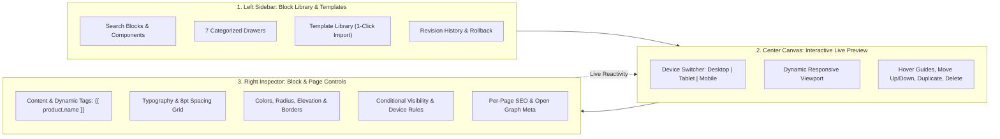

# Sorolata Commerce Platform
## Visual Page Builder Architecture & Technical Specification (Part 04)

---

### Master Philosophy: Elementor's Ease, Framer's Polish, Shopify's Speed

The Sorolata Visual Page Builder is designed from first principles as an **original Block-Based JSON Layout Engine**. Rather than mimicking heavy legacy builders that output bloated HTML and fragmented shortcodes into database rows, Sorolata strictly enforces a **Clean Structured JSON Storage Paradigm**:

```
                       THE SOROLATA BUILDER CREED
    ┌─────────────────────────────────────────────────────────────┐
    │ 1. NEVER store raw HTML in the database                     │
    │ 2. NEVER store Blade code or executable PHP in the database │
    │ 3. NEVER store messy inline CSS strings                     │
    │ 4. Store pure, declarative, versioned JSON schemas only     │
    │ 5. Laravel securely compiles JSON → Native Blade Components │
    └─────────────────────────────────────────────────────────────┘
```

---

### Canonical JSON Schema Specification

Every page and product landing page in Sorolata is stored as a structured JSON object:

```json
{
  "version": 1,
  "page_type": "product",
  "theme": {
    "mode": "warm_heritage",
    "primary_color": "#214E34",
    "accent_color": "#C96A3D",
    "bg_color": "#F8F6F2"
  },
  "sections": [
    {
      "id": "sec_hero_01",
      "type": "hero_cinematic",
      "is_active": true,
      "settings": {
        "aspect_ratio": "16/9",
        "alignment": "center",
        "badge_text": "GI Certified • 100% Handcrafted",
        "headline": "The Ethereal Muslin: {{ product.title }}",
        "subheadline": "Crafted by {{ artisan.name }} in {{ district.name }}",
        "primary_cta_text": "Acquire Piece • {{ product.price }}",
        "padding_top": "96px",
        "padding_bottom": "96px"
      },
      "conditions": {
        "stock": "in_stock",
        "device": "all"
      },
      "blocks": []
    },
    {
      "id": "sec_artisan_02",
      "type": "artisan_spotlight",
      "is_active": true,
      "settings": {
        "layout_style": "split_editorial",
        "show_quote": true,
        "quote": "{{ artisan.quote }}"
      },
      "blocks": []
    }
  ],
  "seo": {
    "meta_title": "{{ product.title }} — Authentic Heritage Bengal Craft",
    "meta_description": "Handcrafted by {{ artisan.name }} in {{ district.name }}. Single batch archival drop.",
    "canonical_url": null,
    "og_image": null
  }
}
```

---

### 3-Panel Visual Builder Interface Architecture

The visual builder UI operates with clean spatial ergonomics:



---

### The 7 Block Categories

Sorolata organizes over 40 atomic and compound blocks into 7 logical categories:

| Category | Available Blocks | Capabilities & Dynamic Hooks |
|---|---|---|
| **1. Layout** | `Section`, `Container`, `Grid`, `Columns`, `Tabs`, `Accordion`, `Spacer`, `Divider` | Responsive column spans, gap tokens, background layers |
| **2. Basic** | `Heading`, `Paragraph`, `Button`, `Image`, `Icon`, `List`, `Quote`, `Badge` | Dynamic text tokens, Cormorant Garamond & Manrope fonts |
| **3. Commerce** | `Product Grid`, `Product Slider`, `Featured Product`, `Price`, `Rating`, `Stock`, `Add to Bag`, `Wishlist` | Instant Livewire cart sync, stock status triggers |
| **4. Heritage** | `District Card`, `Artisan Card`, `Craft Story`, `Workshop Gallery`, `Material List`, `Made in BD Badge` | Geographical Indication (GI) tags, artisan studio bios |
| **5. Marketing** | `Banner`, `Hero`, `CTA`, `Newsletter`, `Countdown`, `Offer`, `Coupon`, `Announcement` | Promotional banners, discount counters, flash drop timers |
| **6. Media** | `Video Player`, `Macro Gallery`, `Image Slider`, `Lightbox`, `Instagram Feed` | AVIF/WebP responsive sources, zero-CLS placeholders |
| **7. Social** | `Customer Reviews`, `Collector Testimonials`, `FAQ Accordion`, `Timeline`, `Social Icons` | Verified buyer badges, star aggregates, quote carousels |

---

### Dynamic Data Tag Engine

To allow a single template to render any product, district, or artisan without duplicate code, any text input supports **Dynamic Replacement Tags**:

```
{{ product.title }}         -> The Imperial Sonargaon Muslin Scarf
{{ product.price }}         -> ৳ 18,500
{{ product.compare_price }} -> ৳ 22,000
{{ product.sku }}           -> SRL-MSL-001
{{ artisan.name }}          -> Master Weaver Alimuddin
{{ artisan.atelier }}       -> Shitalakshya Muslin Guild
{{ artisan.quote }}         -> "When dawn mist rises off the Shitalakshya..."
{{ district.name }}         -> Narayanganj (Sonargaon)
{{ district.gi_specialty }} -> Dhakai Muslin & Traditional Jamdani
{{ district.river_basin }}  -> Shitalakshya & Meghna River Basin
```

---

### Conditional Display Engine

Blocks can be conditionally toggled based on runtime application context:
- `stock_status`: Show only if in stock / Show if pre-order.
- `discount_status`: Show only if product has `compare_at_price > price`.
- `auth_status`: Show only for authenticated collectors vs. guests.
- `geo_location`: Show localized shipping message for Bangladesh vs. Expat (USA/UK).
- `viewport_device`: Hide on mobile / Hide on desktop.

---

### Revisions, Autosave & Rollback Engine

- **Real-Time Auto-Save**: Changes debounce every 3 seconds to `page_revisions` with `is_autosave = true`.
- **Draft vs. Published State**: The public storefront renders only the published revision.
- **One-Click Rollback**: Admins can inspect previous versions and restore them instantly.
- **Template Library**: One-click import for pre-configured editorial layouts:
  1. *Imperial Handloom Product Landing*
  2. *Artisan Atelier Showcase*
  3. *Heritage District Provenance Hub*
  4. *Festival Seasonal Drop Page*
  5. *Museum Quality FAQ & Care Guide*
